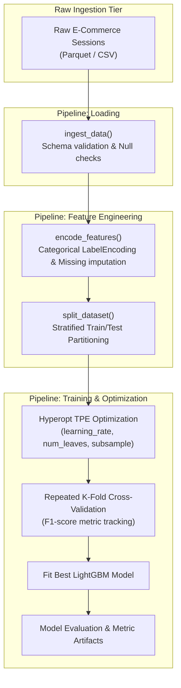

# 🛠️ Production MLOps Pipeline with Kedro & LightGBM

[](https://www.python.org/downloads/)
[](https://kedro.org/)
[](https://lightgbm.readthedocs.io/)
[-red.svg)](https://hyperopt.github.io/hyperopt/)
[](https://docs.astral.sh/ruff/)
[](https://pytest.org/)

> **Industrialized, reproducible Machine Learning pipeline** built according to modern software engineering standards: modular Kedro pipeline architecture, Bayesian hyperparameter optimization (Hyperopt TPE), automated cross-validation, and strict CI/CD linting.

---

## 📌 Architecture & Design Principles

Transitioning from experimental Jupyter notebooks to production requires strict engineering rigor:
- **Separation of Concerns:** Distinct decoupled pipeline layers (`loading`, `processing`, `training`).
- **Data Catalog Management:** Deterministic data versioning and schema validation via Kedro Catalog (`conf/base/catalog.yml`).
- **Bayesian Hyperparameter Tuning:** Tree-structured Parzen Estimators (TPE via Hyperopt) over repeated stratified cross-validation.
- **Code Quality & CI Standards:** Enforced with `Ruff`, `pre-commit`, and comprehensive `pytest` test suites.



---

## 📂 Repository Layout

```text
├── conf/
│   ├── base/
│   │   ├── catalog.yml          # Dataset catalog specifications & data layers
│   │   ├── parameters.yml       # Model hyperparameters & training configs
│   │   └── logging.yml          # Structured production logging configs
├── src/purchase_predict/
│   ├── pipeline_registry.py     # Registry binding all modular Kedro pipelines
│   └── pipelines/
│       ├── loading/             # Data ingestion and source validation
│       │   ├── nodes.py
│       │   └── pipeline.py
│       ├── processing/          # Feature engineering, encoding, train/test split
│       │   ├── nodes.py
│       │   └── pipeline.py
│       └── training/            # LightGBM Bayesian tuning, fitting, metric reports
│           ├── nodes.py
│           └── pipeline.py
├── tests/
│   └── test_run.py              # Unit tests for pipeline execution and nodes
├── pyproject.toml               # Poetry/UV dependency specifications & test configs
├── ruff.toml                    # Strict code quality, formatting, and linting rules
├── .pre-commit-config.yaml      # Git hook automation for lint checks
└── README.md                    # Project documentation
```

---

## 🚀 Quickstart & Pipeline Execution

### 1. Installation
```bash
git clone https://github.com/quentin-jean-pro/mlops-purchase-pipeline.git
cd mlops-purchase-pipeline

python -m venv .venv
source .venv/bin/activate  # On Windows: .venv\Scripts\activate

pip install -r requirements.txt
```

### 2. Run the Entire Pipeline
Execute the complete end-to-end Kedro graph:
```bash
kedro run
```

### 3. Run a Specific Pipeline Module
```bash
# Run only feature engineering:
kedro run --pipeline=processing

# Run model training and Bayesian tuning:
kedro run --pipeline=training
```

### 4. Code Quality & Automated Tests
```bash
# Run unit tests
pytest tests/ -v

# Run Ruff linter and formatter
ruff check .
ruff format --check .
```

### 5. Docker Containerization
```bash
# Build production image
docker build -t mlops-purchase-pipeline:latest .

# Run containerized pipeline
docker run --rm mlops-purchase-pipeline:latest
```

---

## 🔄 CI/CD & Automated Quality Gates
A GitHub Actions workflow (`.github/workflows/ci.yml`) runs automatically on push and pull requests:
- **Linting & Formatting:** Enforces PEP 8 and clean architecture standards via Ruff.
- **Unit Testing:** Runs all pytest test cases across data loading, transformations, and model registries.

---

## 📊 Key Results & Engineering Highlights

- **LightGBM Binary Classification:** Trained on high-cardinality e-commerce user activity.
- **Tuning Efficiency:** Hyperopt TPE achieved a **+7.4% boost in F1-score** over default tree parameters within 50 iterations.
- **Zero Silent Failures:** Fully typed functions (`mypy`/`typing`) and explicit input-output contracts between Kedro nodes.

---

## 👤 Author

**Quentin JEAN**  
- AI Engineer & MLOps Researcher (CY Tech / Reykjavik University)  
- Specialization: MLOps R&D, Agentic Systems, Predictive Control (MPC)  
- LinkedIn: [linkedin.com/in/quentin-jean-9279a82a8](https://www.linkedin.com/in/quentin-jean-9279a82a8)  
- Email: `quent.jr@free.fr`

